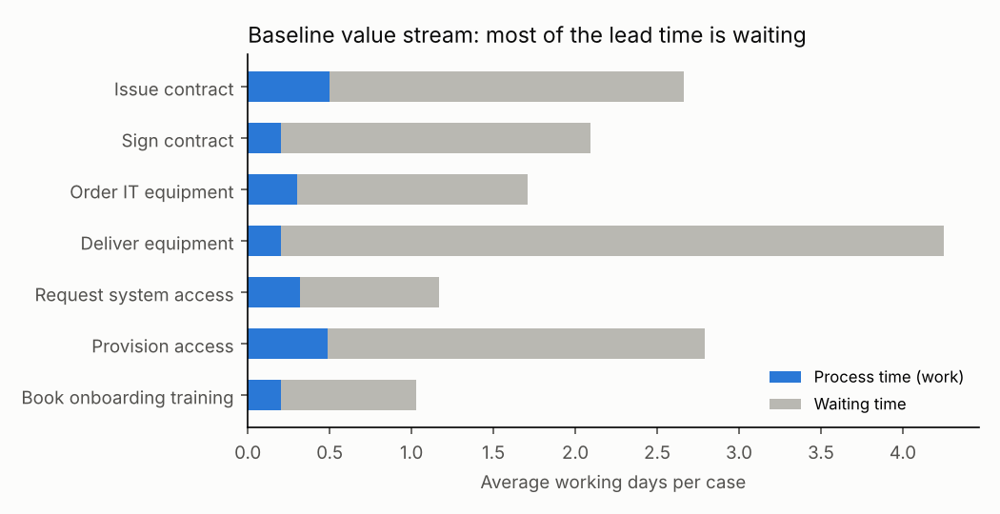
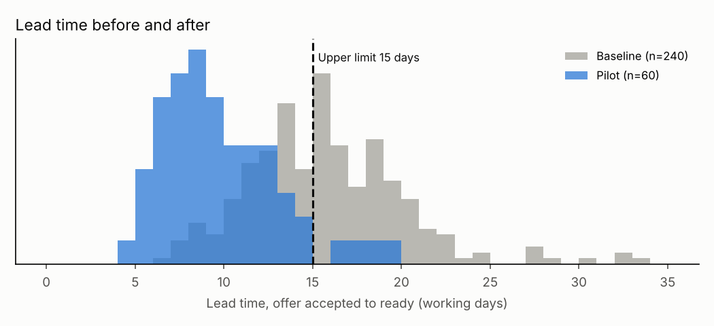
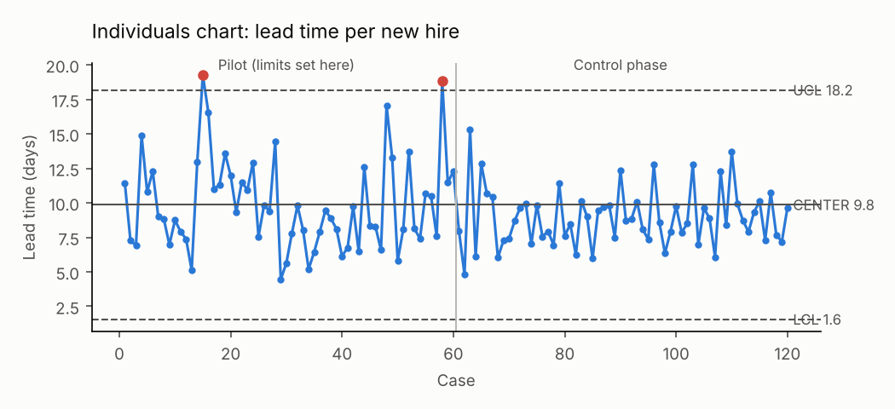

# Lean Six Sigma DMAIC: employee onboarding lead time

A complete DMAIC project on a common HR operations problem: new hires who start without a laptop, system access or a training slot. The company and the data are fictional and generated by the code, with the causes of delay planted on purpose. The method, the tests and the documents are the ones I use as a Lean Six Sigma Black Belt.

```bash
pip install -e ".[dev]"
python -m dmaic      # data/, reports/results.md, charts
pytest               # 10 tests
```

## Define

Half of new hires were not ready on day one. The charter, SIPOC, CTQ tree and data collection plan are in [docs/charter.md](docs/charter.md).

* **CTQ:** offer acceptance to ready (equipment, access, training) in at most 15 working days.
* **Goal:** median below 10 days, at least 80% ready on day one, held for three months.

## Measure

Baseline of 240 new hires in 2025:

| Measure | Baseline |
|---|---|
| Median lead time | 15.4 working days |
| Share over the 15-day limit | 55% (550,000 DPMO, sigma level 1.4) |
| Ppk | -0.05 |
| Ready on day one | 51% |
| Process cycle efficiency | 14% (the other 86% of the lead time is waiting) |



Lead times are right-skewed (Shapiro-Wilk p < 0.001), so capability is also computed from percentiles. Both methods give the same picture.

## Analyze

Waiting for equipment delivery is the largest block (30% of all waiting time). Together with access provisioning and the contract steps it makes up 77%.

| Hypothesis | Test | Result | p | |
|---|---|---|---|---|
| Access requests sent back for missing information slow the case | Mann-Whitney U | median 18.2 vs 14.6 days | 3e-08 | confirmed |
| Late requests from hiring managers slow the case | Mann-Whitney U | 16.6 vs 14.9 days | 2e-04 | confirmed |
| Late requests are less often ready on day one | Chi-square | 6% vs 73% ready | 2e-21 | confirmed |
| Lead time differs by site | Kruskal-Wallis | A 15.1, B 15.4, C 16.4 | 0.25 | not shown |
| Equipment delivery wait differs by site | Kruskal-Wallis | A 2.9, B 3.3, C 4.8 days | 0.006 | confirmed |

The site test is a useful lesson. On total lead time, site C does not stand out, because the other causes add so much variation. On the step where the cause sits (equipment delivery), it does. A regression with all causes together confirms it: rework adds 4.5 days, a late request 3.0 days and site C 1.8 days, each with the others held fixed.

The root cause behind the biggest block is a sequence problem: equipment was ordered only after the contract was signed, although nothing in the order depends on the signature.

## Improve

| Root cause | Change |
|---|---|
| Equipment ordered after contract signature | Order created automatically at offer acceptance, delivery runs in parallel with the contract |
| Access requests sent back | Standard request form with required fields and role-based profiles |
| Late requests from hiring managers | Automatic reminder at offer acceptance |
| Slow delivery at site C | Minimum stock of standard laptops at site C |

Pilot with 60 new hires, February to April 2026:

| Measure | Baseline | Pilot | Test |
|---|---|---|---|
| Median lead time | 15.4 days | 9.2 days (-40%) | Mann-Whitney p = 1e-18 |
| Ready on day one | 51% | 80% | Chi-square p = 8e-05 |
| Share over 15 days | 55% | 7% | |
| Process cycle efficiency | 14% | 21% | |



## Control

Control limits come from the pilot. The next 60 new hires (May to July 2026) stayed inside them with no rule violations, and the share over 15 days fell to 2% (Ppk 0.96).



The control plan, with owners and reactions for each measure, is in [docs/control-plan.md](docs/control-plan.md). Full results: [reports/results.md](reports/results.md).

## Layout

```
src/dmaic/data.py      generated cases (baseline, pilot, control phase)
src/dmaic/analysis.py  value stream, capability, DPMO and sigma, Pareto, hypothesis tests,
                       regression, before/after comparison, I-MR limits, rule checks, p-chart
src/dmaic/__main__.py  runs all phases and writes the report and charts
docs/                  charter with SIPOC and CTQ tree, control plan
data/, reports/        output of the last run
```

## License

MIT
