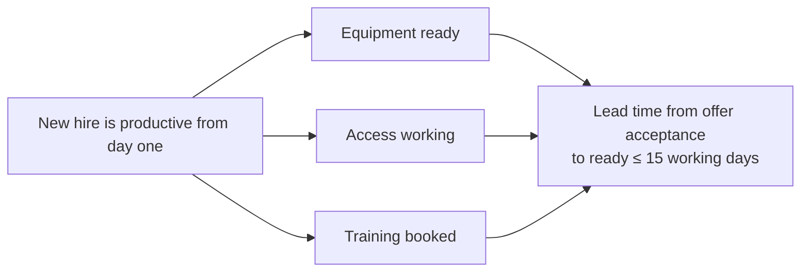

# Define: project charter

The company and all data are fictional. The structure is the one I use for Black Belt projects.

## Project charter

| Item | Content |
|---|---|
| Project | Cut onboarding lead time so new hires are ready on day one |
| Business case | Half of new hires start without a laptop, system access or a training slot. They lose their first days, managers lose time setting them up by hand, and the first impression of the company is poor. |
| Problem statement | In 2025, the median lead time from offer acceptance to "ready" (equipment delivered, access working, training booked) was 15.4 working days. 55% of cases took longer than the 15-day limit, and only 51% of new hires were ready on day one. |
| Goal | Median lead time below 10 working days and at least 80% ready on day one, held for three months after the pilot. |
| CTQ | Lead time from offer acceptance to ready ≤ 15 working days (upper specification limit). |
| In scope | Steps from offer acceptance to ready: contract, IT equipment, system access, training booking. Three sites. |
| Out of scope | Recruiting before the offer, payroll set-up, the content of the onboarding training. |
| Process owner | Head of HR operations (sponsor) |
| Team | Black Belt (lead), HR operations lead, IT service desk lead, two hiring managers, site coordinator for site C |
| Timeline | Define and Measure 4 weeks, Analyze 3 weeks, Improve with pilot 12 weeks, Control 12 weeks |

## SIPOC

| Suppliers | Inputs | Process | Outputs | Customers |
|---|---|---|---|---|
| Recruiter, hiring manager | Accepted offer, start date, role | 1. Issue contract | Signed contract | New hire |
| HR operations | Contract template, personal data | 2. Sign contract | Employee record | Hiring manager |
| IT service desk, hardware vendor | Equipment catalogue, stock | 3. Order IT equipment, 4. deliver it | Laptop and phone at the desk | IT security |
| Access approvers | Role-based access profile | 5. Request access, 6. provision it | Accounts and permissions | Payroll |
| Learning team | Training calendar | 7. Book onboarding training | Training slot | Site coordinator |

## CTQ tree

## Data collection plan

| Measure | Definition | Source | Frequency |
|---|---|---|---|
| Lead time | Working days from offer acceptance to the last of: equipment delivered, access provisioned, training booked | HR system and IT tickets | Per case |
| Process and waiting time per step | Hands-on time and time waiting before each step | Ticket timestamps, sampled time study | Per case |
| Ready on day one | Lead time ≤ days from offer acceptance to start date | HR system | Per case |
| Access rework | Access request sent back for missing information | IT tickets | Per case |
| Late request | Hiring manager request less than 10 days before start | HR system | Per case |
