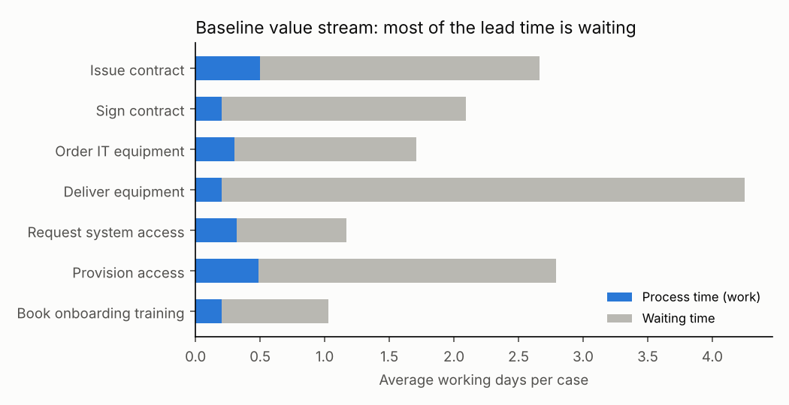
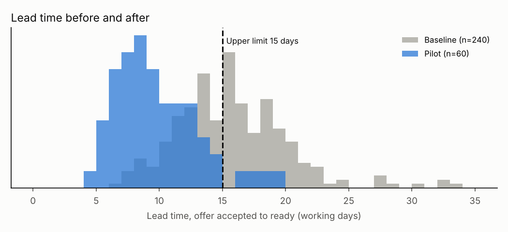
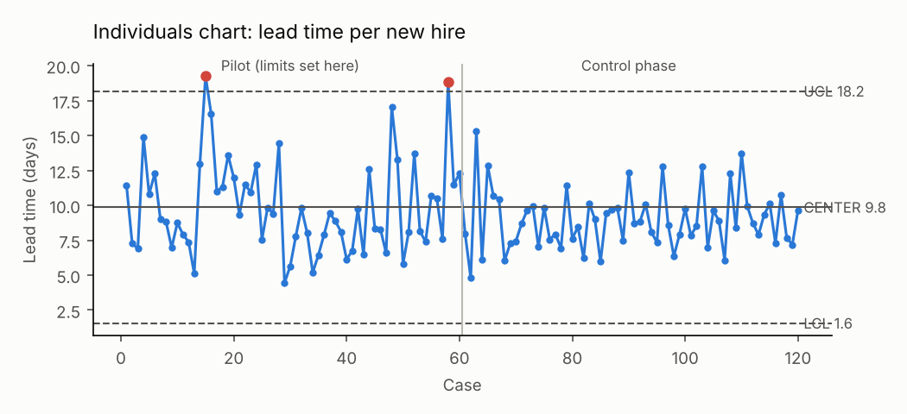

# DMAIC results

Generated by `python -m dmaic`. All data is generated (see `src/dmaic/data.py`).

## Measure

Baseline: 240 new hires in 2025. Process cycle efficiency 14%: the rest of the lead time is waiting.

| step | process_time_days | waiting_time_days | lead_time_days |
|---|---|---|---|
| Issue contract | 0.5 | 2.16 | 2.66 |
| Sign contract | 0.2 | 1.89 | 2.09 |
| Order IT equipment | 0.3 | 1.41 | 1.71 |
| Deliver equipment | 0.2 | 4.05 | 4.25 |
| Request system access | 0.32 | 0.85 | 1.17 |
| Provision access | 0.49 | 2.3 | 2.79 |
| Book onboarding training | 0.2 | 0.83 | 1.03 |

Capability against the 15-day upper limit:

| phase | mean | median | std | ppk_normal | ppk_percentile | share_over_usl | dpmo | sigma_level | normality_p |
|---|---|---|---|---|---|---|---|---|---|
| baseline | 15.71 | 15.38 | 4.5 | -0.05 | -0.02 | 0.55 | 550000 | 1.37 | 0.0 |
| pilot | 9.85 | 9.16 | 3.33 | 0.51 | 0.58 | 0.067 | 66667 | 3.0 | 0.0083 |
| control | 8.94 | 8.7 | 2.1 | 0.96 | 0.97 | 0.017 | 16667 | 3.63 | 0.0445 |

## Analyze

Where the waiting happens:

| step | waiting_days_total | share | cumulative_share |
|---|---|---|---|
| Deliver equipment | 972 | 0.3 | 0.3 |
| Provision access | 552 | 0.17 | 0.47 |
| Issue contract | 518 | 0.16 | 0.63 |
| Sign contract | 454 | 0.14 | 0.77 |
| Order IT equipment | 339 | 0.105 | 0.875 |
| Request system access | 205 | 0.063 | 0.938 |
| Book onboarding training | 200 | 0.062 | 1.0 |

Root cause hypotheses:

| hypothesis | test | effect | p_value | confirmed |
|---|---|---|---|---|
| Cases with access rework take longer | Mann-Whitney U | median 18.2 vs 14.6 days | 2.7e-08 | True |
| Late requests from hiring managers take longer | Mann-Whitney U | median 16.6 vs 14.9 days | 1.6e-04 | True |
| Late requests are less often ready on day one | Chi-square | 6% vs 73% ready | 1.7e-21 | True |
| Lead time differs by site | Kruskal-Wallis | A 15.1, B 15.4, C 16.4 | 2.5e-01 | False |
| Equipment delivery wait differs by site | Kruskal-Wallis | A 2.9, B 3.3, C 4.8 | 5.7e-03 | True |

All causes in one regression (R² = 0.255):

| term | days | std_error | p_value |
|---|---|---|---|
| intercept | 13.32 | 0.44 | 3.8e-83 |
| access_rework | 4.5 | 0.61 | 2.2e-12 |
| late_request | 2.97 | 0.55 | 1.4e-07 |
| site_B | 0.22 | 0.57 | 6.9e-01 |
| site_C | 1.75 | 0.71 | 1.5e-02 |

## Improve

Pilot: 60 new hires, February to April 2026.

| measure | value |
|---|---|
| median_before | 15.4 |
| median_after | 9.2 |
| median_reduction_pct | 40.4 |
| lead_time_p_value | 1.2e-18 |
| std_before | 4.5 |
| std_after | 3.3 |
| variance_p_value | 6.4e-02 |
| ready_day_one_before | 0.508 |
| ready_day_one_after | 0.8 |
| ready_p_value | 8.4e-05 |
| pce_before | 0.141 |
| pce_after | 0.212 |

## Control

Individuals chart limits from the pilot: centre 9.85, UCL 18.16, LCL 1.55. Control phase: 60 new hires, May to July 2026.

Rule violations in the control phase:

None.

Monthly share not ready on day one (p-chart):

| period | n | not_ready | p | ucl | lcl | center | out_of_control |
|---|---|---|---|---|---|---|---|
| 2026-02 | 19 | 5 | 0.263 | 0.367 | 0.0 | 0.133 | False |
| 2026-03 | 21 | 3 | 0.143 | 0.356 | 0.0 | 0.133 | False |
| 2026-04 | 20 | 4 | 0.2 | 0.361 | 0.0 | 0.133 | False |
| 2026-05 | 19 | 1 | 0.053 | 0.367 | 0.0 | 0.133 | False |
| 2026-06 | 21 | 0 | 0.0 | 0.356 | 0.0 | 0.133 | False |
| 2026-07 | 20 | 3 | 0.15 | 0.361 | 0.0 | 0.133 | False |
